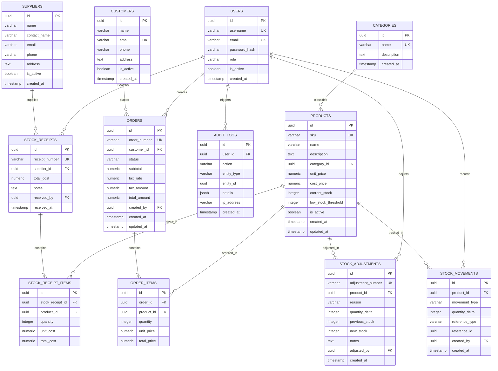

# StockPilot - Database Design Specification

**Course:** CSC418 DevOps for Cloud Computing  
**System:** StockPilot Relational Database Architecture  
**Database Engine:** PostgreSQL 16 (Local Named Volume / Amazon RDS)  
**Version:** 1.0.0  

---

## 1. Schema Philosophy & Design Principles

The StockPilot relational database design enforces business invariants and financial precision at the engine level rather than relying solely on application-layer logic:
- **No Floating-Point Money:** All financial attributes (costs, prices, subtotals, taxes, and totals) are stored strictly as `NUMERIC(12, 2)` to eliminate floating-point rounding errors.
- **Physical Invariant Enforcement:** Stock quantities are protected by PostgreSQL check constraints (`CHECK (current_stock >= 0)`), guaranteeing that overselling or negative stock cannot be persisted even if an application bug attempts it.
- **Immutable Financial & Inventory Ledgers:** Inventory movements are recorded into an append-only `stock_movements` ledger table. Historical rows are never edited or silently deleted.
- **Preserved Transactional History:** Soft deactivation (`is_active = FALSE`) is used for products, customers, and suppliers to ensure historical orders remain referentially sound.

---

## 2. Entity-Relationship Diagram (ERD)

---

## 3. Detailed Table Specifications

### 3.1 `users` Table
Stores authenticated system actors (administrators and operational staff).

| Column Name | Data Type | Constraints | Description |
| :--- | :--- | :--- | :--- |
| `id` | `UUID` | `PRIMARY KEY`, default `gen_random_uuid()` | Unique user identifier |
| `username` | `VARCHAR(50)` | `NOT NULL`, `UNIQUE` | Login username |
| `email` | `VARCHAR(255)` | `NOT NULL`, `UNIQUE` | User contact email |
| `password_hash`| `VARCHAR(255)` | `NOT NULL` | Bcrypt hashed credentials |
| `role` | `VARCHAR(20)` | `NOT NULL`, `CHECK (role IN ('admin', 'staff'))` | Role authorization level |
| `is_active` | `BOOLEAN` | `NOT NULL`, default `TRUE` | Soft deactivation flag |
| `created_at` | `TIMESTAMPTZ` | `NOT NULL`, default `NOW()` | Timestamp of record creation |

### 3.2 `categories` Table
Organizes products into logical product groups.

| Column Name | Data Type | Constraints | Description |
| :--- | :--- | :--- | :--- |
| `id` | `UUID` | `PRIMARY KEY`, default `gen_random_uuid()` | Primary Key |
| `name` | `VARCHAR(100)` | `NOT NULL`, `UNIQUE` | Unique category name |
| `description` | `TEXT` | `NULL` | Detailed category scope |
| `created_at` | `TIMESTAMPTZ` | `NOT NULL`, default `NOW()` | Record creation timestamp |

### 3.3 `products` Table
Core product entity managing pricing, current inventory, and alert thresholds.

| Column Name | Data Type | Constraints | Description |
| :--- | :--- | :--- | :--- |
| `id` | `UUID` | `PRIMARY KEY`, default `gen_random_uuid()` | Primary Key |
| `sku` | `VARCHAR(50)` | `NOT NULL`, `UNIQUE` | Unique Stock Keeping Unit |
| `name` | `VARCHAR(200)` | `NOT NULL` | Commercial product title |
| `description` | `TEXT` | `NULL` | Technical / sales description |
| `category_id` | `UUID` | `NOT NULL`, `REFERENCES categories(id) ON DELETE RESTRICT` | Owning category |
| `unit_price` | `NUMERIC(12, 2)` | `NOT NULL`, `CHECK (unit_price >= 0)` | Customer selling price |
| `cost_price` | `NUMERIC(12, 2)` | `NOT NULL`, `CHECK (cost_price >= 0)` | Supplier purchasing cost |
| `current_stock`| `INTEGER` | `NOT NULL`, default 0, `CHECK (current_stock >= 0)` | Real-time stock count |
| `low_stock_threshold` | `INTEGER` | `NOT NULL`, default 10, `CHECK (low_stock_threshold >= 0)` | Alert boundary |
| `is_active` | `BOOLEAN` | `NOT NULL`, default `TRUE` | Soft deletion status |
| `created_at` | `TIMESTAMPTZ` | `NOT NULL`, default `NOW()` | Creation timestamp |
| `updated_at` | `TIMESTAMPTZ` | `NOT NULL`, default `NOW()` | Last modified timestamp |

### 3.4 `orders` Table
Encapsulates customer order status, financial totals, and timestamps.

| Column Name | Data Type | Constraints | Description |
| :--- | :--- | :--- | :--- |
| `id` | `UUID` | `PRIMARY KEY`, default `gen_random_uuid()` | Primary Key |
| `order_number` | `VARCHAR(50)` | `NOT NULL`, `UNIQUE` | Human-readable ID (e.g. `ORD-20261024-001`) |
| `customer_id` | `UUID` | `NOT NULL`, `REFERENCES customers(id) ON DELETE RESTRICT` | Placing customer |
| `status` | `VARCHAR(20)` | `NOT NULL`, `CHECK (status IN ('PENDING', 'CONFIRMED', 'CANCELLED'))` | Order state |
| `subtotal` | `NUMERIC(12, 2)` | `NOT NULL`, `CHECK (subtotal >= 0)` | Pre-tax sum of items |
| `tax_rate` | `NUMERIC(5, 4)` | `NOT NULL`, default `0.0000` | Tax percentage (e.g. 0.0500) |
| `tax_amount` | `NUMERIC(12, 2)` | `NOT NULL`, default `0.00` | Calculated tax |
| `total_amount` | `NUMERIC(12, 2)` | `NOT NULL`, `CHECK (total_amount >= 0)` | Grand total payable |
| `created_by` | `UUID` | `NOT NULL`, `REFERENCES users(id)` | Creator user ID |
| `created_at` | `TIMESTAMPTZ` | `NOT NULL`, default `NOW()` | Order placement time |
| `updated_at` | `TIMESTAMPTZ` | `NOT NULL`, default `NOW()` | Last status transition time |

### 3.5 `order_items` Table
Individual line items belonging to an order with snapshot pricing.

| Column Name | Data Type | Constraints | Description |
| :--- | :--- | :--- | :--- |
| `id` | `UUID` | `PRIMARY KEY`, default `gen_random_uuid()` | Primary Key |
| `order_id` | `UUID` | `NOT NULL`, `REFERENCES orders(id) ON DELETE CASCADE` | Parent order |
| `product_id` | `UUID` | `NOT NULL`, `REFERENCES products(id) ON DELETE RESTRICT` | Product sold |
| `quantity` | `INTEGER` | `NOT NULL`, `CHECK (quantity > 0)` | Units purchased |
| `unit_price` | `NUMERIC(12, 2)` | `NOT NULL`, `CHECK (unit_price >= 0)` | Snapshot price at checkout |
| `total_price` | `NUMERIC(12, 2)` | `NOT NULL`, `CHECK (total_price >= 0)` | `quantity * unit_price` |

### 3.6 `stock_movements` Table (Immutable Ledger)
Every inventory change is permanently appended to this audit ledger.

| Column Name | Data Type | Constraints | Description |
| :--- | :--- | :--- | :--- |
| `id` | `UUID` | `PRIMARY KEY`, default `gen_random_uuid()` | Primary Key |
| `product_id` | `UUID` | `NOT NULL`, `REFERENCES products(id) ON DELETE RESTRICT` | Affected product |
| `movement_type`| `VARCHAR(30)` | `NOT NULL`, `CHECK (movement_type IN ('RECEIPT', 'ADJUSTMENT', 'ORDER_DEDUCT', 'ORDER_RESTOCK'))` | Movement category |
| `quantity_delta`| `INTEGER` | `NOT NULL`, `CHECK (quantity_delta != 0)` | Positive or negative delta |
| `reference_type`| `VARCHAR(30)` | `NOT NULL` (e.g., `'ORDER'`, `'RECEIPT'`, `'ADJUSTMENT'`) | Linked entity type |
| `reference_id` | `UUID` | `NOT NULL` | Linked entity primary key |
| `created_by` | `UUID` | `NOT NULL`, `REFERENCES users(id)` | User authorizing movement |
| `created_at` | `TIMESTAMPTZ` | `NOT NULL`, default `NOW()` | Creation timestamp |

---

## 4. Indexing & Optimization Strategy

1. **Unique Indexes:**
   - `users(username)` and `users(email)`
   - `products(sku)`
   - `categories(name)`
   - `orders(order_number)`
   - `stock_receipts(receipt_number)`
2. **Foreign Key Performance Indexes:**
   - `products(category_id)`
   - `order_items(order_id)` and `order_items(product_id)`
   - `stock_receipt_items(stock_receipt_id)` and `stock_receipt_items(product_id)`
   - `stock_movements(product_id)`
3. **Temporal & Query Filtering Indexes:**
   - `stock_movements(created_at DESC)`: High-performance sorting of movement ledger.
   - `orders(status, created_at DESC)`: Fast dashboard queries for open orders.
   - `products(current_stock, low_stock_threshold)`: Immediate lookup of items requiring reorder.
